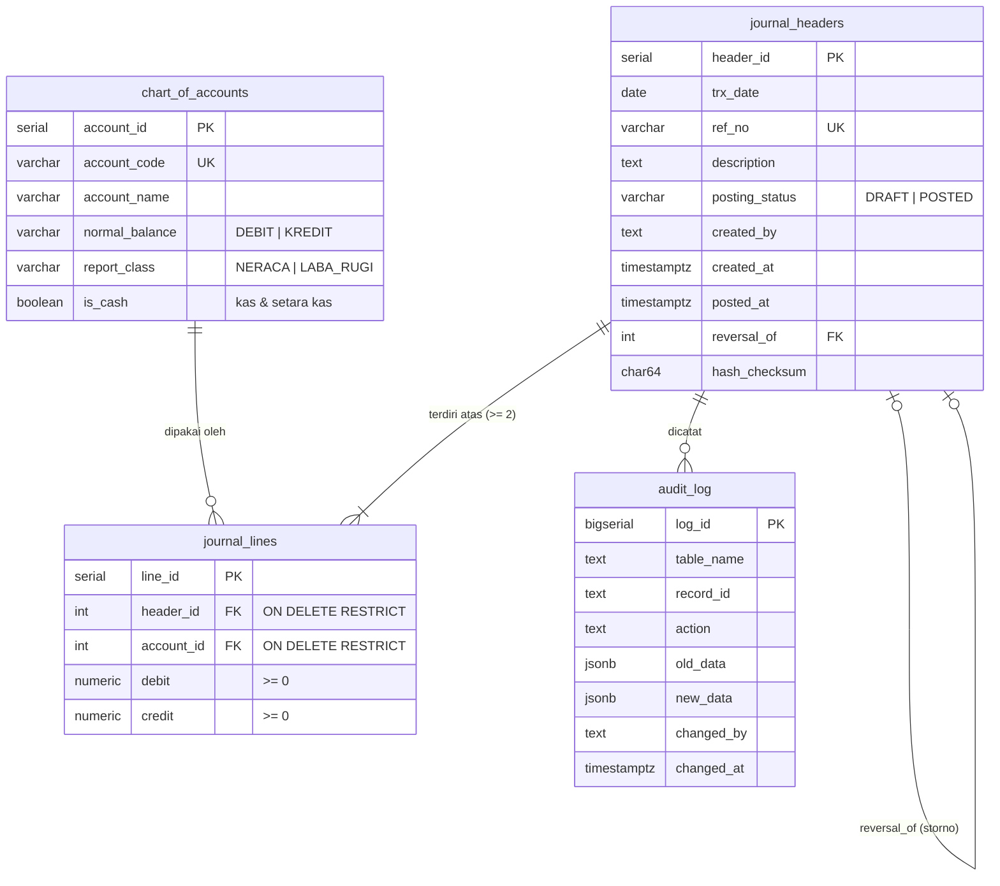

# UTS Pemrograman / Coding — Akuntansi FEB Undip 2026/2027

| | |
|---|---|
| **Nama** | Farel Fachreza Rusli |
| **NIM** | 12030124140334 |
| **Kelas** | Pengkodean dan Pemrograman — Kelas E |
| **Dosen** | Totok Dewayanto |
| **Demo web (Soal 3)** | https://farelrames.github.io/uts-coding-akuntansi/ |
| **Database** | Supabase (PostgreSQL 17.11), region Singapore |

## Struktur repositori

```
├── index.html                         Soal 3 – form Voucher Kas Keluar (live di GitHub Pages)
├── sql/
│   ├── 01_soal1_general_ledger.sql    Soal 1 – DDL COA, journal_headers, journal_lines + penegakan double-entry
│   ├── 02_soal2_inventory_trigger.sql Soal 2.1 – trg_update_stock_and_journal()
│   ├── 03_soal2_concurrency.sql       Soal 2.2 – SELECT … FOR UPDATE vs SERIALIZABLE + demo 2 sesi
│   ├── 04_soal3_audit_trail.sql       Soal 3.2 – immutability POSTED, storno, hash, audit_log, RPC, RLS
│   └── 05_tests.sql                   28 skenario uji otomatis
├── docs/
│   ├── hasil_uji.md                   hasil uji + bug yang ditemukan
│   ├── uji_api_bypass.md              serangan langsung ke REST API (konteks Soal 1)
│   └── img/                           screenshot bukti
└── ai-logs/
    ├── 01_gemini_canvas.md            prompt, output & review kode Gemini Canvas
    └── 02_notebooklm.md               prompt, sumber & ringkasan verifikasi PSAK
```

Cara menjalankan ulang: buat project Supabase baru → SQL Editor → jalankan `01`, `02`, `04`, lalu `05` → ganti
`SUPABASE_URL`/`SUPABASE_KEY` di `index.html` → buka file di browser.

## Soal 1 — ERD



**Penegakan asas berpasangan di database (bukan di frontend):**

| Lapisan | Mekanisme |
|---|---|
| Per baris | `CHECK debit >= 0`, `CHECK credit >= 0`, `CHECK NOT (debit = 0 AND credit = 0)`, `CHECK (debit = 0 OR credit = 0)` |
| Per jurnal | `CONSTRAINT TRIGGER … DEFERRABLE INITIALLY DEFERRED` → Σ debit = Σ kredit dicek saat **COMMIT** |
| Posting | trigger: hanya boleh POSTED bila ≥ 2 baris & seimbang |
| API | RLS + `REVOKE INSERT/UPDATE/DELETE` dari `anon`/`authenticated`; satu-satunya pintu tulis = RPC |

### 1.3 Mengapa Header–Line lebih andal daripada tabel jurnal tunggal

* **3NF** — Pada tabel datar, tanggal, nomor bukti, deskripsi, status, dan pembuat diulang di setiap baris.
  Atribut itu bergantung pada *nomor bukti*, bukan pada kunci baris (dependensi transitif), sehingga terjadi
  anomali update: satu baris bisa saja diubah tanggalnya sementara pasangannya tidak, dan jurnal "terbelah".
  Dengan Header–Line, fakta transaksi disimpan sekali, sedangkan baris hanya menyimpan akun dan nominal.
* **Unit keseimbangan yang jelas** — Debit = Kredit hanya bermakna per transaksi. Header memberi batas yang tegas
  (`header_id`) untuk constraint trigger. Pada tabel datar, pasangan baris harus ditebak lewat nomor bukti teks.
* **Jejak audit** — Status posting, `created_by`, `posted_at`, `hash_checksum`, dan `reversal_of` melekat pada satu
  dokumen sumber. Kunci *immutability* cukup diterapkan pada header POSTED, dan semua barisnya ikut terkunci.
  Storno menunjuk ke header asal (`reversal_of UNIQUE`), sehingga rantai koreksi dapat ditelusuri dan tidak bisa dibalik dua kali.
* **Integritas referensial** — `ON DELETE RESTRICT` mencegah akun atau dokumen yang sudah dipakai terhapus,
  sehingga tidak ada baris yatim (orphan) yang membuat neraca saldo tidak seimbang.

## Soal 2 — Ringkasan

* `trg_update_stock_and_journal()` (AFTER INSERT): kunci baris item `FOR UPDATE` → validasi stok →
  `RAISE EXCEPTION` bila negatif → update `stock_qty` → **jurnal Persediaan/HPP otomatis POSTED** pada transaksi yang sama,
  sehingga stok fisik dan buku besar tidak pernah selisih (uji S2-8: fisik 485.000 = buku 485.000).
* Race condition dibuktikan nyata dengan dua tab SQL Editor: kasir B tertahan ±13 detik lalu ditolak
  "Stok BRG-002 tidak cukup: tersedia 0, diminta 1" (lihat `docs/hasil_uji.md`).

## Soal 3 — Ringkasan

* **Form** (`index.html`): live indicator Debit/Kredit/Selisih, tombol Submit aktif hanya bila seimbang dan ada
  kredit kas, daftar alasan nonaktif, tabel jurnal + status hash, tombol storno, dan panel audit log.
* **Backend** (Supabase RPC): `post_cash_voucher()`, `reverse_journal()`; trigger kunci POSTED (UPDATE/DELETE/TRUNCATE);
  `created_by` diambil dari JWT/penyusun dan tidak bisa ditimpa; `created_at = now()`; `hash_checksum = SHA-256` atas isi kanonik
  header + baris; view `v_journal_integrity` menghitung ulang hash untuk mendeteksi manipulasi.
* **AI tools**: lihat `ai-logs/`. Gemini Canvas menghasilkan rancangan UI. Review manual menemukan 6 masalah,
  2 di antaranya membuat form tidak berfungsi. NotebookLM memverifikasi aturan terhadap PSAK 207/201 dan memberi rekomendasi
  cek saldo kas, yang kemudian diimplementasikan (S3-12).

## Keterbatasan & pengembangan lanjutan

* `shortcut:` RPC terbuka untuk `anon` dan `created_by` diisi sendiri oleh pengguna agar purwarupa bisa dicoba tanpa login.
  Produksi: Supabase Auth, sehingga `created_by` = email JWT, dan RPC hanya untuk `authenticated`.
* Modul **mutasi kas internal** (isi kas kecil, penempatan deposito ≤ 3 bulan), tag aktivitas arus kas, valas,
  dan tutup buku per periode (rekomendasi NotebookLM #1–#4).
* Nilai persediaan memakai `unit_cost` tetap di master barang karena tabel transaksi dari soal tidak memiliki harga beli.
  Untuk rata-rata bergerak, perlu menambah kolom biaya per transaksi.
