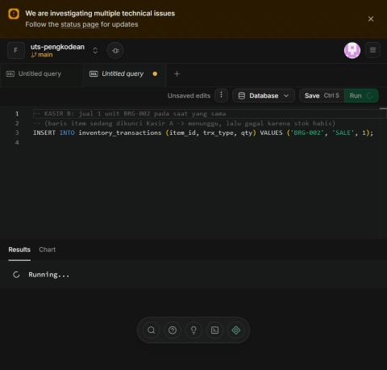
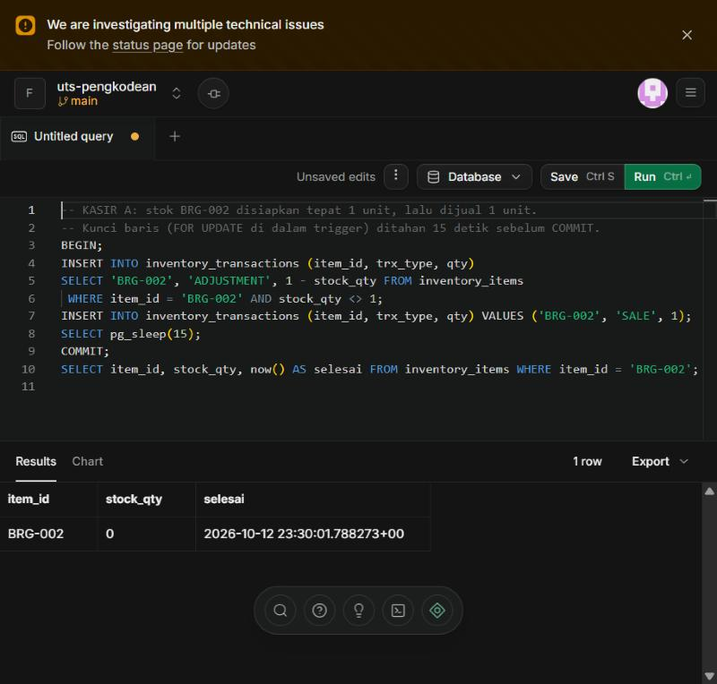
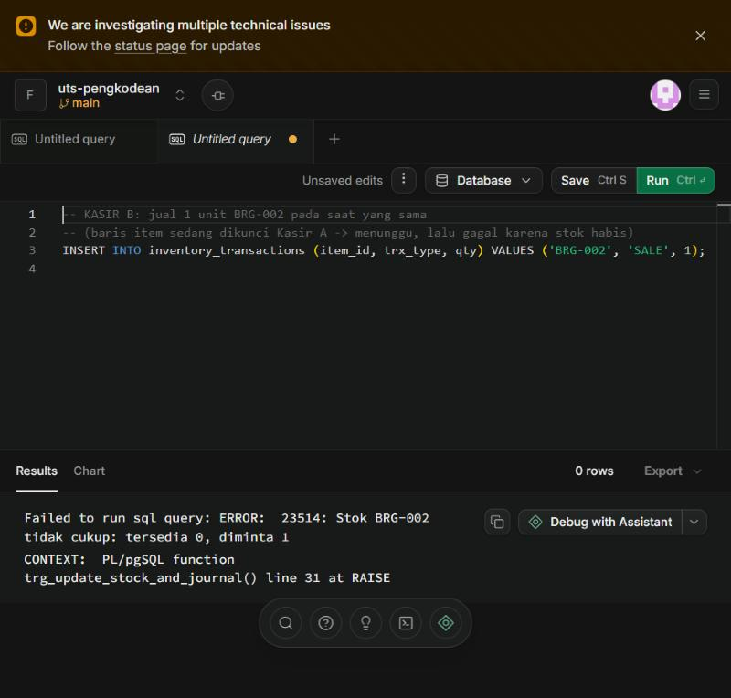
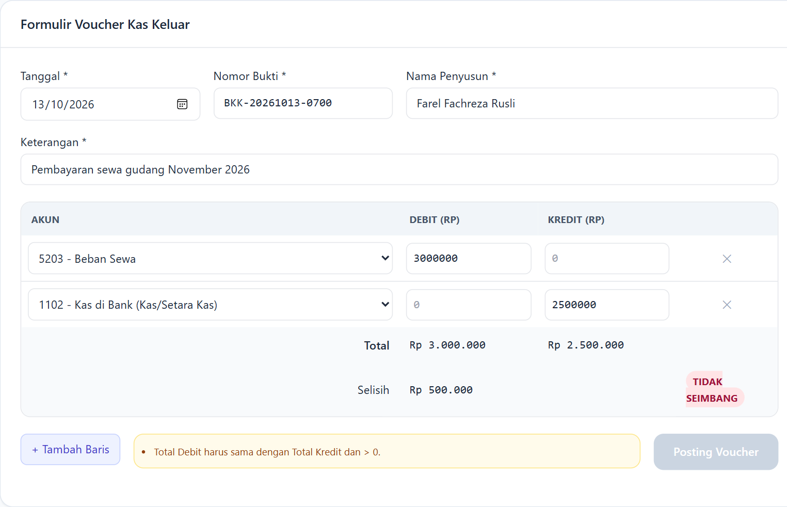
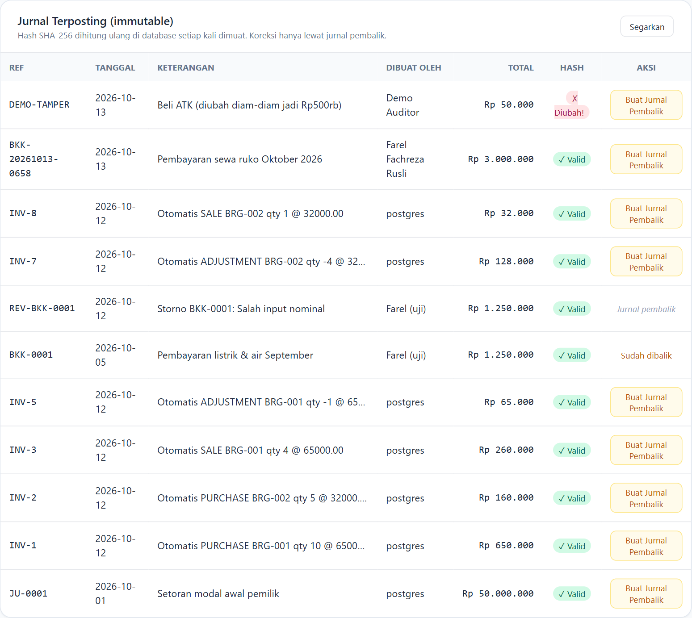

# Hasil Uji Otomatis (`sql/05_tests.sql`)

Dijalankan di Supabase SQL Editor (PostgreSQL 17.11, project `uts-pengkodean`, region ap-southeast-1) pada 13 Oktober 2026.
28/28 skenario sesuai ekspektasi (27 pada run pertama + S3-12 setelah verifikasi NotebookLM).

| Kode | Skenario | Ekspektasi | Hasil aktual | Status |
|---|---|---|---|---|
| S1-1 | Jurnal seimbang (setoran modal Rp50 jt) | LOLOS | LOLOS | OK |
| S1-2 | Posting jurnal JU-0001 | LOLOS | LOLOS | OK |
| S1-3 | Jurnal tidak seimbang dikirim langsung (Dr 1 jt, Cr 900 rb) | DITOLAK | Jurnal header_id=2 tidak seimbang: Debit 1000000.00 <> Kredit 900000.00 | OK |
| S1-4 | Baris dengan debit negatif | DITOLAK | new row for relation "journal_lines" violates check constraint "chk_debit_nonneg" | OK |
| S1-5 | Baris dengan debit = 0 dan kredit = 0 | DITOLAK | violates check constraint "chk_not_both_zero" | OK |
| S1-6 | Satu baris berisi debit dan kredit sekaligus | DITOLAK | violates check constraint "chk_one_side" | OK |
| S1-7 | Hapus akun COA yang sudah dipakai (ON DELETE RESTRICT) | DITOLAK | violates foreign key constraint "journal_lines_account_id_fkey" | OK |
| S1-8 | Header langsung dibuat POSTED tanpa baris | DITOLAK | Jurnal baru harus DRAFT; isi baris dulu, baru di-POST | OK |
| S2-1 | PURCHASE BRG-001 qty 10 | LOLOS | LOLOS | OK |
| S2-2 | PURCHASE BRG-002 qty 5 | LOLOS | LOLOS | OK |
| S2-3 | SALE BRG-001 qty 4 (stok 10) | LOLOS | LOLOS | OK |
| S2-4 | SALE BRG-001 qty 7 (stok 6) → negatif | DITOLAK | Stok BRG-001 tidak cukup: tersedia 6, diminta 7 | OK |
| S2-5 | ADJUSTMENT BRG-001 qty −1 (barang rusak) | LOLOS | LOLOS | OK |
| S2-6 | SALE dengan qty 0 | DITOLAK | Qty 0 tidak valid: SALE harus > 0 | OK |
| S2-7 | Stok akhir BRG-001 = 10 − 4 − 1 | stok=5 | stok=5 | OK |
| S2-8 | Rekonsiliasi nilai fisik gudang = saldo akun Persediaan | SAMA | SAMA (fisik 485000.00 / buku 485000.00) | OK |
| S3-1 | RPC voucher kas keluar seimbang (bayar listrik) | LOLOS | LOLOS | OK |
| S3-2 | RPC voucher tidak seimbang | DITOLAK | Jurnal BKK-0002 tidak dapat di-POST: 2 baris, Debit 500000.00, Kredit 450000.00 | OK |
| S3-3 | RPC voucher tanpa akun kas di sisi kredit | DITOLAK | Voucher kas keluar wajib mengkredit akun kas/setara kas | OK |
| S3-4 | RPC voucher bertanggal masa depan | DITOLAK | Tanggal transaksi wajib dan tidak boleh di masa depan | OK |
| S3-5 | UPDATE header jurnal POSTED | DITOLAK | Jurnal BKK-0001 sudah POSTED dan tidak boleh diubah. Gunakan reverse_journal() | OK |
| S3-6 | DELETE header jurnal POSTED | DITOLAK | Jurnal BKK-0001 sudah POSTED dan tidak boleh dihapus. Gunakan reverse_journal() | OK |
| S3-7 | UPDATE nominal baris jurnal POSTED | DITOLAK | Baris jurnal milik jurnal POSTED tidak boleh di-UPDATE | OK |
| S3-8 | reverse_journal(BKK-0001) membuat storno | LOLOS | LOLOS | OK |
| S3-9 | reverse_journal(BKK-0001) kedua kali | DITOLAK | Jurnal BKK-0001 sudah pernah dibalik | OK |
| S3-10 | Hapus isi audit_log | DITOLAK | audit_log bersifat append-only: DELETE dilarang | OK |
| S3-11 | Semua jurnal POSTED: hash tersimpan = hash dihitung ulang | VALID | VALID (7 jurnal) | OK |
| S3-12 | RPC voucher melebihi saldo Kas Kecil (saldo 0) — *ditambahkan setelah verifikasi NotebookLM* | DITOLAK | Saldo 1101 Kas Kecil tidak mencukupi (akan menjadi -100000.00) | OK |

> **Bug yang ditemukan saat uji lewat API**: server Supabase memakai zona waktu **UTC**. Pada 13-10-2026 pukul ±06.40 WIB,
> `current_date` server masih 12-10-2026 sehingga voucher bertanggal hari ini ditolak sebagai "tanggal masa depan".
> Perbaikan: `ALTER DATABASE ... SET timezone = 'Asia/Jakarta'` (file 01) dan atribut `SET timezone = 'Asia/Jakarta'`
> pada fungsi `post_cash_voucher` & `reverse_journal` (file 04) agar tidak bergantung pada koneksi pool.

> Catatan: pada run pertama S1-4 menyasar jurnal yang sudah POSTED sehingga ditolak oleh kunci immutability
> (bukan oleh CHECK). Skenario diperbaiki agar memakai jurnal DRAFT dan diuji ulang → ditolak oleh `chk_debit_nonneg` (SQLSTATE 23514).

## Demo race condition (Soal 2.2)

Dua tab SQL Editor = dua koneksi/kasir. Stok BRG-002 = 1.

* **Kasir A**: `BEGIN; INSERT SALE 1; pg_sleep(15); COMMIT;` → stok menjadi 0.
* **Kasir B** (dijalankan 2 detik kemudian): status *Running…* selama ±13 detik (menunggu kunci `FOR UPDATE`),
  lalu `ERROR 23514: Stok BRG-002 tidak cukup: tersedia 0, diminta 1`.

## Uji end-to-end form (GitHub Pages → Supabase)

| Langkah | Hasil |
|---|---|
| Dr 5203 Beban Sewa 3.000.000 / Cr 1102 Kas di Bank 2.500.000 | Badge **TIDAK SEIMBANG**, selisih Rp 500.000, Submit nonaktif + alasan |
| Kredit diubah menjadi 3.000.000 | Badge **SEIMBANG**, Submit aktif |
| Klik *Posting Voucher* | "Voucher BKK-20261013-0658 berhasil di-POST (header_id 20)", hash ✓ Valid; audit log: INSERT header, 2× INSERT baris, UPDATE (posting) |

## Demo deteksi manipulasi (`sql/06_demo_tamper.sql`)

Superuser mematikan `trg_jh_lock`, mengubah keterangan jurnal POSTED `DEMO-TAMPER`, lalu menyalakan trigger lagi.
Hasil: `v_journal_integrity.hash_valid = false` → form menampilkan **✗ Diubah!**, dan `audit_log` tetap merekam
`UPDATE` oleh `postgres` dengan nilai lama ("Beli ATK (jurnal demo manipulasi)") dan baru ("…diubah diam-diam jadi Rp500rb").
Kunci *immutability* bisa dibobol pemilik database, tetapi pembobolan itu **tidak bisa disembunyikan**.

